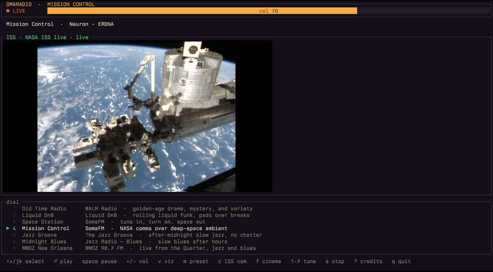
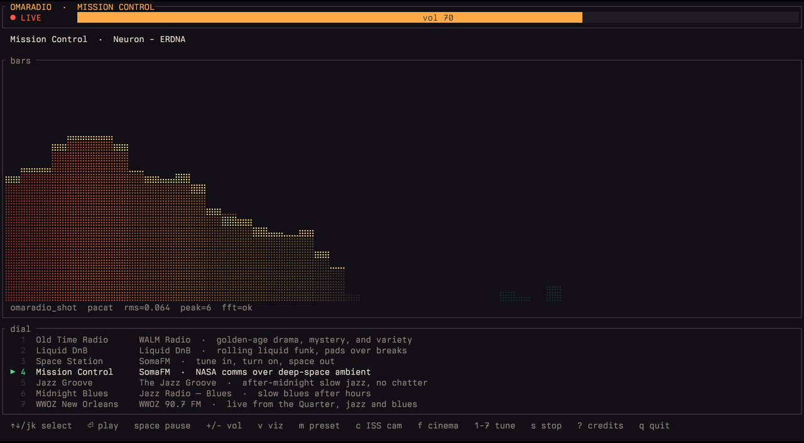
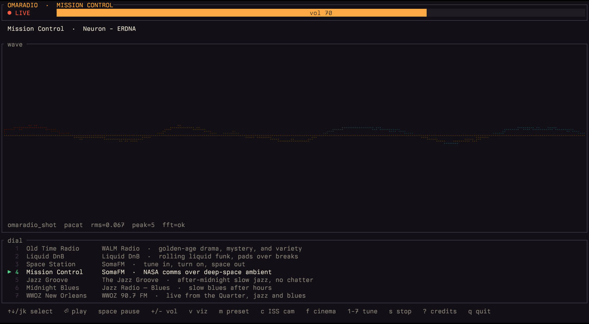
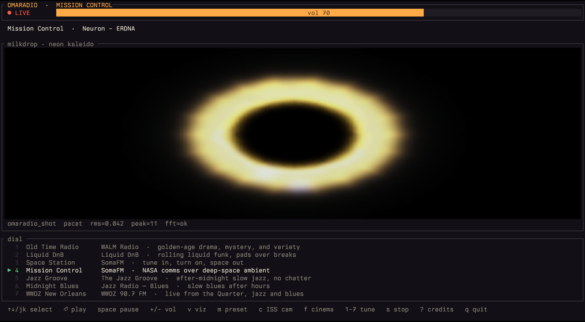
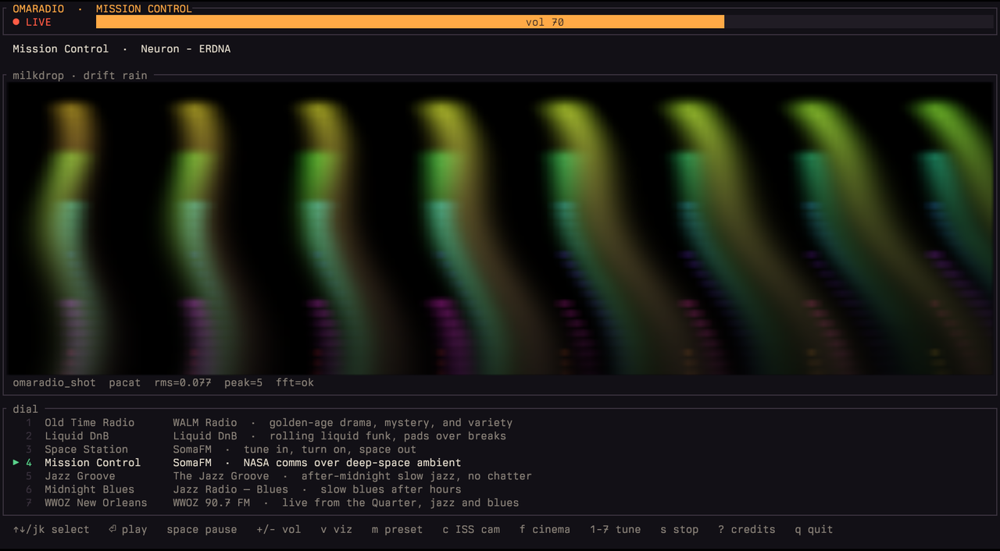

# omaradio

Night-dial terminal radio. A small TUI with [mpv](https://mpv.io) doing the playback, a live view of the speaker mix, and a control socket so a script or an agent can drive it. Built to live in a tiling terminal on [Omarchy](https://omarchy.org); it runs on any Linux terminal that can launch mpv.

<p align="center">
  
</p>

<p align="center">
  
  
</p>

<p align="center">
  
  
</p>

The shots are Kitty on Omarchy. The bars, wave, and milkdrop read the PipeWire sink monitor, not a stand-in oscillator.

## Requirements

| Tool | Required for |
|---|---|
| Rust 1.88 | building (`rust-toolchain.toml` pins 1.88.0) |
| mpv | playback |
| `pactl` and `pw-record` (PipeWire) | live spectrum, oscilloscope, and milkdrop |
| yt-dlp and ffmpeg | the ISS earth view |
| Kitty | pixel blits of milkdrop and ISS. Other terminals get a cell fallback |

## Install

```bash
curl -fsSL https://raw.githubusercontent.com/newjordan/omaradio/main/install.sh | sh
```

The script checks for mpv, PipeWire, yt-dlp, and ffmpeg, offers to install what your package manager can, builds a release binary, and puts `omaradio` on `~/.cargo/bin`. Pass `--milkdrop` to also build the optional projectM collection. Pass `--yes` to skip the package-install prompt.

From a checkout:

```bash
# Omarchy / Arch
sudo pacman -S --needed mpv pipewire-pulse yt-dlp ffmpeg
cargo install --path . --locked --force
omaradio
```

`cargo install` needs the 1.88 toolchain. rustup reads `rust-toolchain.toml` and installs it.

## Run

```bash
omaradio
omaradio --help
omaradio --version
```

On startup the radio tunes **Mission Control** and opens the **ISS** view. Playback starts at volume 70. mpv is spawned with `--audio-client-name=omaradio` and dies with the process.

`omaradio --prove-tap` plays a short 8 kHz tone through that same mpv client and checks that the FFT hears it. It refuses to start when another `omaradio` is already running, because the tone comes out of the speakers.

## Keys

| Key | Action |
|---|---|
| `↑` `↓` / `k` `j` | Move the selection |
| `Enter` / `l` | Play the selection |
| `Space` | Pause or resume. With nothing loaded, plays the selection |
| `s` | Stop |
| `←` `→` / `+` `-` (also `=` `_`) | Volume by 5, clamped to 0–130 |
| `[` `p` / `]` `n` | Previous / next station, and play it |
| `1`–`9` | Tune that dial slot, when it exists |
| `v` | Cycle visuals: bars → wave → milkdrop → ISS |
| `f` | Full-window milkdrop or ISS. `f` or `Esc` leaves it |
| `m` | Next built-in milkdrop preset. Also switches to the built-in engine |
| `M` | Next projectM collection preset, bringing the engine up on first use |
| `c` | Next ISS camera, when the ISS view is showing |
| `?` / `h` | Credits. `?`, `h`, `Enter`, or `Esc` closes the card |
| `q` / `Esc` / `Ctrl-C` | Quit. `Esc` leaves fullscreen first |

The footer is two lines and stays inside 80 columns. A failed control socket is reported there (`ctl offline · …`) instead of being dropped.

## The dial

Nine stations ship with the binary:

| # | id | Station | Broadcaster |
|---|---|---|---|
| 1 | `otr` | Old Time Radio | [WALM Radio](https://walmradio.com) |
| 2 | `liquid` | Liquid DnB | Liquid DnB |
| 3 | `space` | Space Station | [SomaFM](https://somafm.com/spacestation/) |
| 4 | `mission` | Mission Control | [SomaFM](https://somafm.com/missioncontrol/) |
| 5 | `jazz` | Jazz Groove | [The Jazz Groove](https://www.thejazzgroove.com) |
| 6 | `blues` | Midnight Blues | [Jazz Radio](https://www.jazzradio.fr) |
| 7 | `wwoz` | WWOZ New Orleans | [WWOZ 90.7 FM](https://www.wwoz.org) |
| 8 | `portland` | All Classical Portland | [All Classical Radio](https://www.allclassical.org) |
| 9 | `swiss` | Radio Swiss Classic | [SRG SSR](https://www.radioswissclassic.ch) |

Streams belong to those broadcasters. This is an unofficial tuner. Credits are in [ATTRIBUTION.md](ATTRIBUTION.md) and on the `?` card.

The dial list scrolls so the selection stays on screen, and the selected row is highlighted. A stream tuned by URL (not on the dial) is pinned at the top of the list while it plays.

`~/.config/omaradio/stations.json` replaces the built-in list when the file exists. Override the directory with `OMARADIO_CONFIG_DIR` or the usual `XDG_CONFIG_HOME`. The first `add` writes the built-ins plus the new station, so nothing is dropped. Hand edits need `omaradio ctl reload` or a restart. A reload that fails to parse keeps the dial that was already loaded.

```json
{ "stations": [
  { "id": "swiss", "name": "Radio Swiss Classic",
    "url": "https://stream.srg-ssr.ch/m/rsc_de/mp3_128",
    "blurb": "slow, peaceful classical", "source": "SRG SSR",
    "homepage": "https://www.radioswissclassic.ch", "mood": "classical" }
] }
```

Only `id`, `name`, and `url` are required. `id` is `[A-Za-z0-9_-]`. `url` must be `http://` or `https://`. `mood` is one of `voice`, `liquid`, `space`, `mission`, `jazz`, `blues`, `brass`, `classical` (a few aliases are accepted: `talk`, `dnb`, `ambient`, `funk`, `soul`, `orchestral`, `chamber`). It colours the visuals. `accent` is an optional `[r, g, b]`.

## Control socket

A running omaradio listens on `$XDG_RUNTIME_DIR/omaradio.ctl.sock` (override with `OMARADIO_CTL_SOCKET`) and speaks one JSON object per line. The connection stays open for the next command. `omaradio ctl` is the client. With no subcommand it sends `status`. `omaradio ctl help` prints the command list and exits 0.

```bash
omaradio ctl status
omaradio ctl tune swiss          # id, 1-based number, name, or http(s) url
omaradio ctl volume -10          # or +10, or an absolute 0–130
omaradio ctl viz milkdrop
omaradio ctl preset collection
omaradio ctl add kexp KEXP https://kexp-mp3-128.streamguys1.com/kexp128.mp3 \
  --mood brass --tune
```

`tune` checks an exact id before a dial number, so a station whose id is `10` is that station, not "the 10th row". The same order applies to names: exact name, then a name fragment.

`play`, `pause`, `toggle`, `stop`, `next`, `prev`, `stations`, `reload`, `remove`, and `quit` are the rest of the command set. `pause` when nothing is loaded returns an error instead of flipping an idle player. A URL tune pauses, stops, and drives the visuals the same way a dial station does.

Replies are JSON. `ok: false` carries an `error` string and the client exits 1. `--json` prints one compact line. The status object is documented in [AGENTS.md](AGENTS.md), including the tap block (`fft_ok`, `rms`) and the milkdrop block (`engine`, `preset`, `collection_error`).

mpv and projectM warnings go to `$XDG_RUNTIME_DIR/omaradio.log` while the TUI is up, so they do not land in the middle of the screen.

## Visuals

`v` cycles four views.

* **bars** — 48 braille columns from a live FFT of the sink monitor, with peak-hold. The visual language is adapted from [CrabMusic](https://github.com/newjordan/crabmusic).
* **wave** — an oscilloscope of the same samples.
* **milkdrop** — a built-in feedback renderer with eight presets: liquid tunnel, solar swirl, ice ripple, neon kaleido, drift rain, deep zoom, orbit fire, bar storm. Presets also rotate on a beat once they have been up for a while. `m` steps them by hand.
* **ISS** — NASA's public HD earth view, fetched on your machine with yt-dlp. Audio stays on the radio. `c` cycles three cameras: NASA ISS live, NASA HD cams, then Sen 4K (that one has overlays). On Kitty, mpv paints the pane directly.

The mix HUD under bars, wave, and milkdrop shows the sink, the capture backend, RMS, the peak bar, and whether the FFT is hearing anything. The volume gauge runs to 130, which is mpv's maximum, and turns amber above 100.

One-shot lines (visual changes, camera names, tune errors, collection errors) stay on the status row for a few seconds. The transport line no longer replaces them on the next frame.

## MilkDrop collection

`M` uses [projectM](https://github.com/projectM-visualizer/projectm) and the Cream of the Crop preset pack. It is optional and not linked in. The setup script builds libprojectM into `~/.local` and prints how many `.milk` files it fetched:

```bash
scripts/setup-milkdrop.sh
# or: install.sh --milkdrop
```

Without it, `M` says the collection is unavailable and `m` keeps the eight built-in presets. Override paths with `OMARADIO_PROJECTM_LIB`, `OMARADIO_MILK_PRESETS`, and `OMARADIO_EGL_DEVICE`.

## Develop

```bash
cargo fmt --all -- --check
cargo clippy --all-targets --locked -- -D warnings
cargo test --locked --all-targets
```

GitHub Actions runs those three on Rust 1.88 after installing mpv. The two mpv acceptance tests look `mpv` up on `PATH` (or `$MPV`) and play `tests/fake_16x9.mp4`.

Library modules live in `src/lib.rs`. `src/main.rs` is the TUI, the `--prove-tap` check, and the tone WAV writer.

## License

omaradio is [MIT](LICENSE) © 2026 Frosty40.

CrabMusic's MIT notice is preserved in [`third_party/CRABMUSIC_LICENSE`](third_party/CRABMUSIC_LICENSE). mpv (GPL-2.0-or-later) and projectM (LGPL-2.1-or-later) stay separate programs and libraries you install yourself. omaradio spawns one and `dlopen`s the other, and links neither. MilkDrop presets belong to their authors.

Not affiliated with SomaFM, WWOZ, WALM, The Jazz Groove, Jazz Radio, All Classical Radio, SRG SSR, Omarchy, mpv, projectM, NASA, or Sen. SomaFM® is a trademark of SomaFM. ISS imagery remains NASA's public stream.
